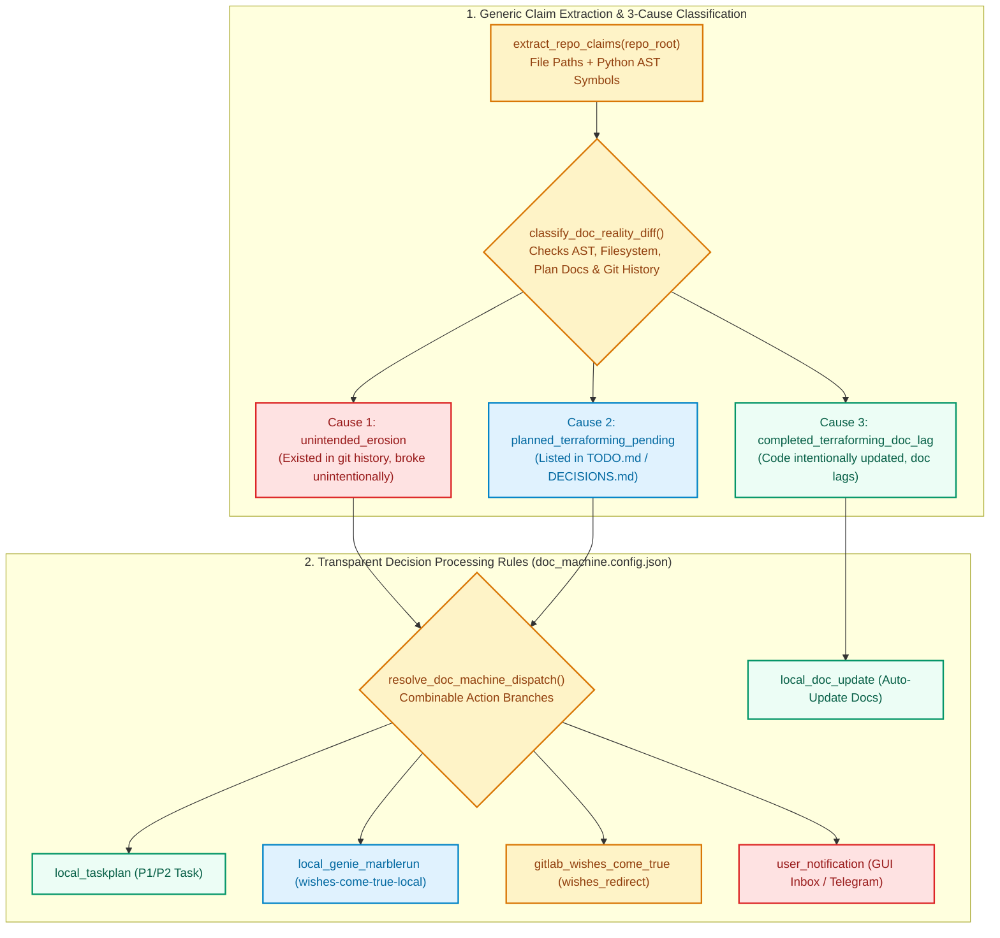

# doc-keeper — 3-Cause Documentation Machine & Decision Rule Router (`ellmos.module.v2`)

**English** | [Deutsch](README_de.md)

`doc-keeper` (`ellmos-doc-keeper`) is a standalone, zero-dependency Python module and CLI tool for **Open Ocean**, **BACH**, and **arbitrary Git repositories**. It extracts verifiable documentation claims (file paths, AST Python symbols, CLI flags) and classifies every discrepancy between documentation and code reality into one of **3 deterministic causes** governed by transparent, combinable **Decision Processing Rules (`config/doc_machine.config.json`)**.

---

## Architecture: The 3-Cause Documentation Model

When documentation (`README*.md`, `SKILL.md`, `docs/**/*.md`, `system/docs/help/*.txt`) diverges from measured code reality, `doc-keeper` never blindly overwrites target architecture:

| Cause (`classify_doc_reality_diff`) | Meaning | Transparent Action Branches (`selected_branches`) |
|---|---|---|
| **1. `unintended_erosion`** | Documentation states intended SOLL, code broke or drifted unintentionally (`git log -S` proof). | **`["local_taskplan", "user_notification"]`** — keep SOLL in doc, create P1 repair task, notify operator. |
| **2. `planned_terraforming_pending`** | Documentation describes planned target architecture from `TODO.md` / `DECISIONS.md` not yet finished in code. | **`["local_taskplan"]`** — create/sync P2 task and separate **SOLL vs. IST** in documentation. |
| **3. `completed_terraforming_doc_lag`** | Code was intentionally advanced, documentation lags behind. | **`["local_doc_update"]`** — update documentation and translations locally. |



---

## Quickstart (CLI & Python API)

```bash
pip install -e .

# Audit any repository and output structured JSON report
python -m doc_keeper audit /path/to/repo --json

# Inspect active Decision Processing Rules for a repository
python -m doc_keeper rules /path/to/repo
```

```python
from doc_keeper import audit_repository, classify_doc_reality_diff, resolve_doc_machine_dispatch

report = audit_repository(".")
print(report["summary"])
```
