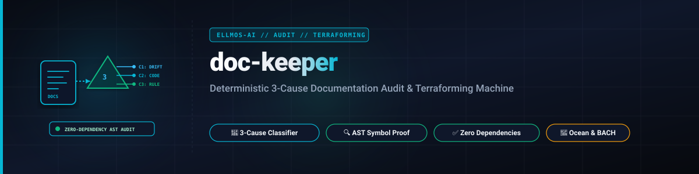
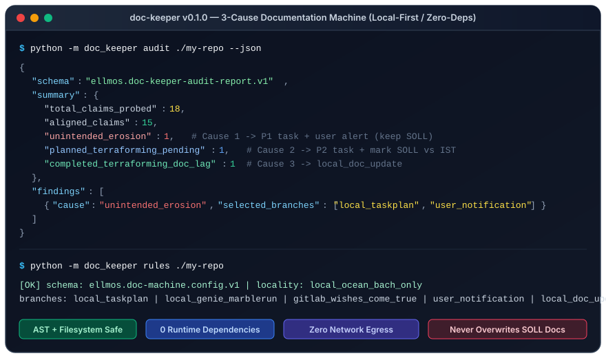
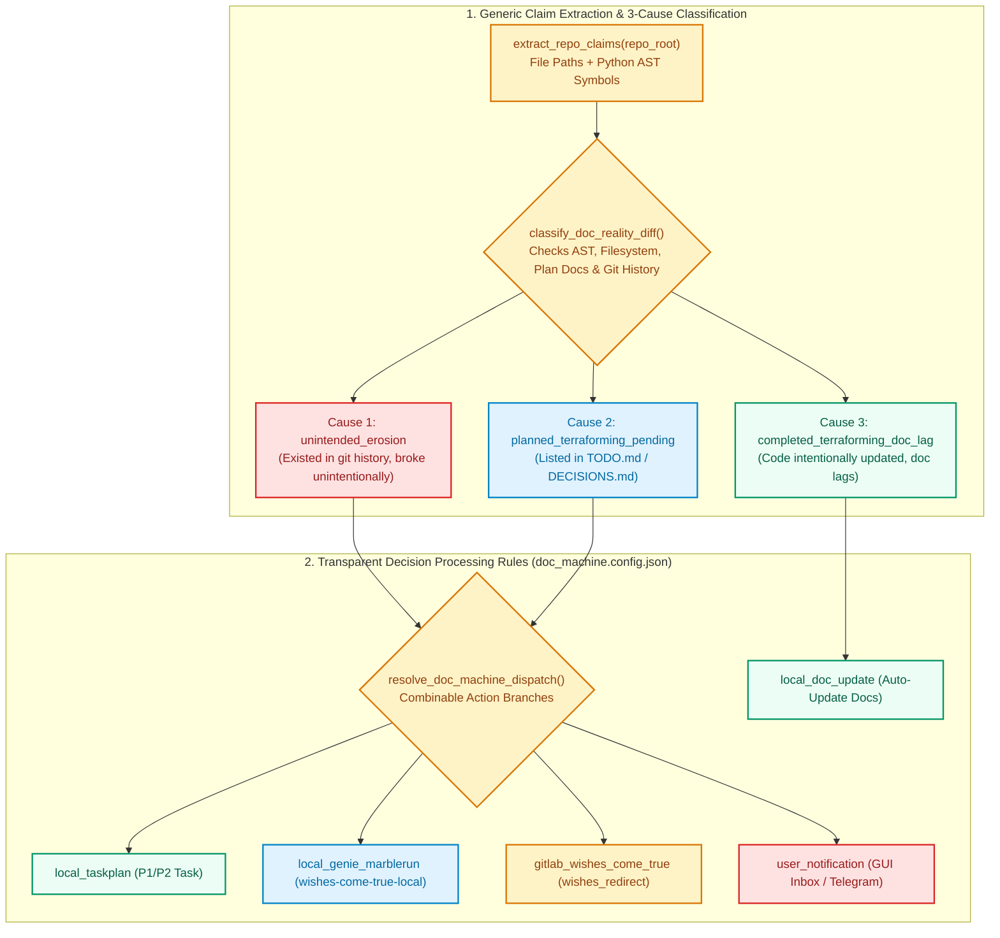
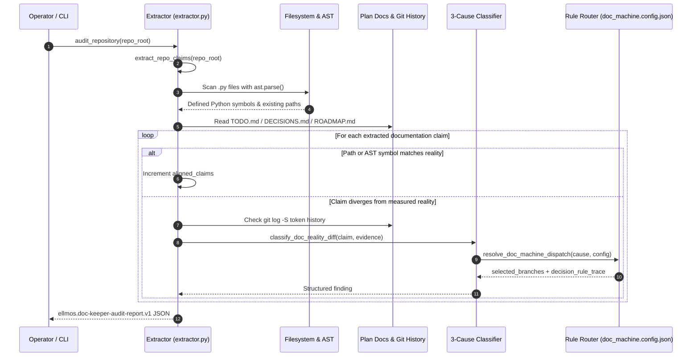

<p align="center">
  
</p>

# doc-keeper — 3-Cause Documentation Machine & Decision Rule Router (`ellmos.module.v2`)

**English** | [Deutsch](README_de.md)

[](pyproject.toml)
[](LICENSE)
[-0284c7.svg)](THIRD_PARTY_LICENSES.md)
[-6366f1.svg)](src/doc_keeper/py.typed)
[-16a34a.svg)](tests/test_metadata.py)
[](CHANGELOG.md)
[](ellmos-module.v2.json)

`doc-keeper` (`ellmos-doc-keeper`) is a standalone, zero-dependency Python module and CLI tool for **Open Ocean**, **BACH**, and **arbitrary Git repositories**. It extracts verifiable documentation claims (file paths, Python AST symbols) from Markdown files and classifies every discrepancy between documentation and measured code reality into one of **3 deterministic causes** governed by transparent, combinable **Decision Processing Rules** ([`config/doc_machine.config.json`](config/doc_machine.config.json)).

---

## Navigation

1. [Terminal Workflow Preview](#sec-01-preview)
2. [Architecture: The 3-Cause Documentation Model](#sec-02-architecture)
3. [Deterministic Audit & Dispatch Lifecycle (Sequence)](#sec-03-sequence)
4. [Quickstart (CLI & Python API)](#sec-04-quickstart)
5. [Install with your LLM (P-022)](#sec-05-llm-install)
6. [Decision Processing Rules & Branches](#sec-06-rules)
7. [Agent Role Prompts & Module Manifest](#sec-07-roles)
8. [Repository Structure](#sec-08-structure)
9. [Community, Governance & License](#sec-09-community)

---

<a id="sec-01-preview"></a>
## 1. Terminal Workflow Preview



---

<a id="sec-02-architecture"></a>
## 2. Architecture: The 3-Cause Documentation Model

When documentation (`README*.md`, `SKILL*.md`, `docs/**/*.md`, `system/docs/help/*.txt`) diverges from measured code reality, `doc-keeper` never blindly overwrites intended target architecture (**SOLL**):

| Cause (`classify_doc_reality_diff()`) | Meaning | Transparent Action Branches (`selected_branches`) |
|---|---|---|
| **1. `unintended_erosion`** | Documentation states intended SOLL, code broke or drifted unintentionally (`git log -S` proof). | **`["local_taskplan", "user_notification"]`** — keep SOLL in doc, create P1 repair task, notify operator. |
| **2. `planned_terraforming_pending`** | Documentation describes planned target architecture from `TODO.md` / `DECISIONS.md` not yet finished in code. | **`["local_taskplan"]`** — create/sync P2 task and separate **SOLL vs. IST** in documentation. |
| **3. `completed_terraforming_doc_lag`** | Code was intentionally advanced, documentation lags behind. | **`["local_doc_update"]`** — update documentation and translations locally. |



---

<a id="sec-03-sequence"></a>
## 3. Deterministic Audit & Dispatch Lifecycle

`audit_repository()` orchestrates claim extraction, static verification, 3-Cause classification, and rule routing without executing any audited code or making network requests:



---

<a id="sec-04-quickstart"></a>
## 4. Quickstart (CLI & Python API)

### Prerequisites & Installation

- **Python:** `>=3.10` (zero third-party runtime dependencies; Python standard library only)
- **Optional:** `git` on `PATH` for `git log -S` erosion checks

```bash
python -m venv .venv
# Linux/macOS: source .venv/bin/activate
# Windows:     .venv\Scripts\activate
pip install -e .
```

### CLI Usage

```bash
# Audit any repository and output structured JSON report
python -m doc_keeper audit /path/to/repo --json

# Write the audit report to a JSON file
python -m doc_keeper audit /path/to/repo --output audit_report.json

# Inspect active Decision Processing Rules for a repository
python -m doc_keeper rules /path/to/repo
```

### Python API

```python
from doc_keeper import (
    audit_repository,
    classify_doc_reality_diff,
    extract_repo_claims,
    load_doc_machine_config,
    resolve_doc_machine_dispatch,
)

claims = extract_repo_claims(".")
report = audit_repository(".")
cfg = load_doc_machine_config(".")
print(report["summary"])
```

---

<a id="sec-05-llm-install"></a>
## 5. Install with your LLM

Copy the prompt below into your coding assistant to install and verify `doc-keeper` safely in an isolated virtual environment (for machine-readable details see [`llms.txt`](llms.txt), [`llm.txt`](llm.txt), and [`SKILL.md`](SKILL.md)):

```text
Install and verify https://github.com/ellmos-ai/doc-keeper (prefer a pinned commit or release tag; never run unverified curl|sh pipes):
1. Read llms.txt and SKILL.md in the repository root first.
2. Create an isolated Python virtual environment (.venv) and run `pip install -e .`.
3. Verify the installation with `python -m doc_keeper --help`, `python -m doc_keeper audit . --json`, and `python -m pytest -ra -v`, then report the results.
```

---

<a id="sec-06-rules"></a>
## 6. Decision Processing Rules & Branches

Rules are loaded via `load_doc_machine_config()` from `config/doc_machine.config.json` (and optional `config_override` dicts) and support 5 combinable branches (`AVAILABLE_DECISION_BRANCHES`):

| Branch | Purpose |
|---|---|
| `local_taskplan` | Create or sync P1 (`unintended_erosion`) / P2 (`planned_terraforming_pending`) tasks in Ocean/BACH taskplan |
| `local_doc_update` | Update local documentation and translations when code leads (`completed_terraforming_doc_lag`) |
| `user_notification` | Notify operator via GUI inbox or optional Telegram channel |
| `local_genie_marblerun` | Multi-step local MarbleRun relay (`wishes-come-true-local`) |
| `gitlab_wishes_come_true` | Developer-tier redirect (`wishes_redirect`) for authorized `ocean-dev` / `ocean-admin` tiers |

---

<a id="sec-07-roles"></a>
## 7. Agent Role Prompts & Module Manifest

`doc-keeper` ships as an `ellmos.module.v2` module ([`ellmos-module.v2.json`](ellmos-module.v2.json)) with ready-to-use bilingual role prompts for multi-agent workflows:

- English role prompt: [`prompts/DOC-KEEPER.en.md`](prompts/DOC-KEEPER.en.md)
- German role prompt: [`prompts/DOC-KEEPER.de.md`](prompts/DOC-KEEPER.de.md)
- Product skill (P-022): [`SKILL.md`](SKILL.md)
- LLM entry index: [`llms.txt`](llms.txt) · [`llm.txt`](llm.txt)

---

<a id="sec-08-structure"></a>
## 8. Repository Structure

```text
doc-keeper/
├── assets/terminal-workflow.svg     # Dark-mode CLI workflow visual
├── config/doc_machine.config.json   # Default 3-Cause & Decision Processing Rules
├── prompts/                         # Bilingual DOC-KEEPER agent prompts (EN/DE)
├── src/doc_keeper/
│   ├── __init__.py                  # Public API exports
│   ├── __main__.py                  # `python -m doc_keeper` entrypoint
│   ├── classifier.py                # 3-Cause classifier & rule router
│   ├── cli.py                       # CLI (`audit`, `rules`)
│   ├── extractor.py                 # Path & Python AST claim extractor
│   └── py.typed                     # PEP 561 type marker
├── tests/                           # Unit & contract test suite
├── SKILL.md                         # Product skill for LLMs (P-022)
├── llms.txt / llm.txt               # Machine-readable LLM entrypoint
└── ellmos-module.v2.json            # Module manifest (`ellmos.module.v2`)
```

---

<a id="sec-09-community"></a>
## 9. Community, Governance & License

- **License:** [MIT License](LICENSE) · [Third-Party Licenses](THIRD_PARTY_LICENSES.md)
- **Contributing:** [Contributing Guide (DE/EN)](CONTRIBUTING.md) · [Code of Conduct (DE/EN)](CODE_OF_CONDUCT.md)
- **Security:** [Security Policy](SECURITY.md) (Private Vulnerability Reporting)
- **Changelog:** [CHANGELOG.md](CHANGELOG.md) · [Project Status & Tasks](TODO.md)
