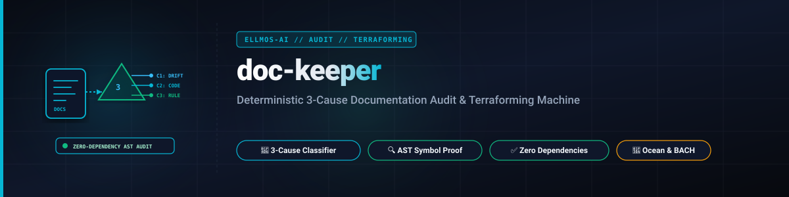
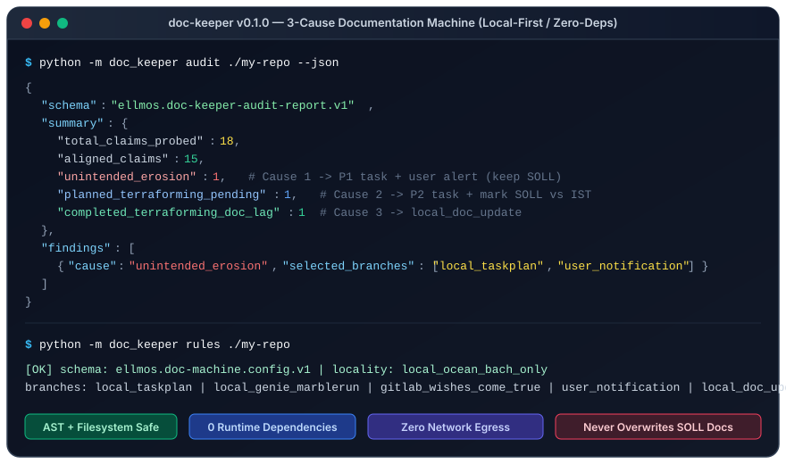
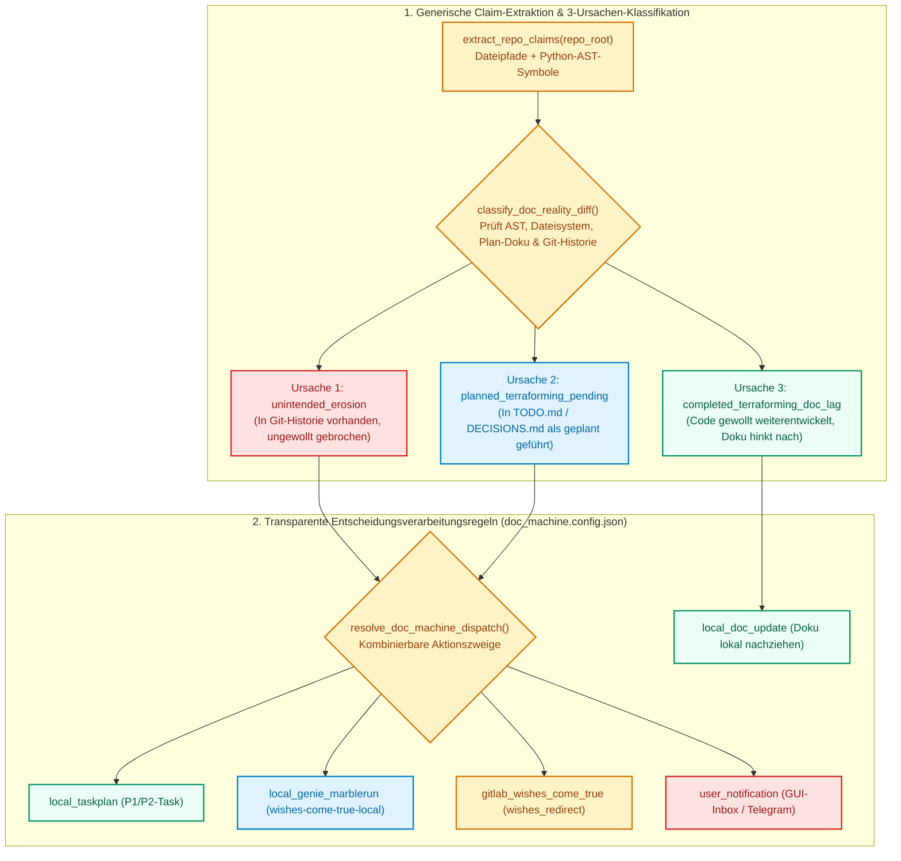
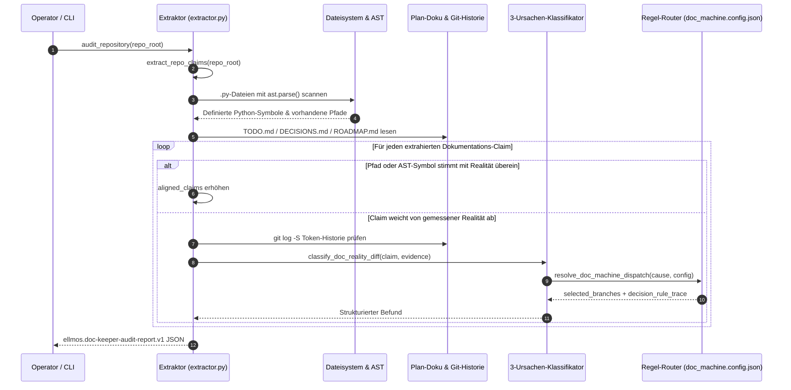

<p align="center">
  
</p>

# doc-keeper — 3-Ursachen-Dokumentationsmaschine & Entscheidungs-Router (`ellmos.module.v2`)

[English](README.md) | **Deutsch**

[](pyproject.toml)
[](LICENSE)
[-0284c7.svg)](THIRD_PARTY_LICENSES.md)
[-6366f1.svg)](src/doc_keeper/py.typed)
[-16a34a.svg)](tests/test_metadata.py)
[](CHANGELOG.md)
[](ellmos-module.v2.json)

`doc-keeper` (`ellmos-doc-keeper`) ist ein eigenständiges, abhängigkeitsfreies Python-Modul und CLI-Werkzeug für **Open Ocean**, **BACH** und **beliebige Git-Repositories**. Es extrahiert prüfbare Dokumentations-Aussagen (Dateipfade, Python-AST-Symbole) aus Markdown-Dateien und klassifiziert jede Abweichung zwischen Dokumentation und gemessener Code-Realität deterministisch in eine der **3 Ursachen** anhand transparenter, frei kombinierbarer **Entscheidungsverarbeitungsregeln** ([`config/doc_machine.config.json`](config/doc_machine.config.json)).

---

## Navigation

1. [Terminal-Workflow-Vorschau](#sec-01-preview)
2. [Architektur: Das 3-Ursachen-Dokumentationsmodell](#sec-02-architecture)
3. [Deterministischer Audit- & Dispatch-Lebenszyklus (Sequenz)](#sec-03-sequence)
4. [Schnellstart (CLI & Python-API)](#sec-04-quickstart)
5. [Mit deinem LLM installieren (P-022)](#sec-05-llm-install)
6. [Entscheidungsverarbeitungsregeln & Zweige](#sec-06-rules)
7. [Agenten-Rollenprompts & Modul-Manifest](#sec-07-roles)
8. [Repository-Struktur](#sec-08-structure)
9. [Community, Governance & Lizenz](#sec-09-community)

---

<a id="sec-01-preview"></a>
## 1. Terminal-Workflow-Vorschau



---

<a id="sec-02-architecture"></a>
## 2. Architektur: Das 3-Ursachen-Dokumentationsmodell

Stellt `doc-keeper` eine Abweichung zwischen Dokumentation (`README*.md`, `SKILL*.md`, `docs/**/*.md`, `system/docs/help/*.txt`) und Code-Realität fest, überschreibt er niemals blind gewollte **SOLL**-Architektur:

| Ursache (`classify_doc_reality_diff()`) | Bedeutung | Transparente Aktionszweige (`selected_branches`) |
|---|---|---|
| **1. `unintended_erosion`** | Doku beschreibt gewolltes SOLL, Code ist ungewollt kaputtgegangen/abgedriftet (`git log -S`-Beleg). | **`["local_taskplan", "user_notification"]`** — SOLL in Doku bewahren, P1-Reparatur-Task einstellen, Nutzer informieren. |
| **2. `planned_terraforming_pending`** | Vorauseilende Doku aus `TODO.md` / `DECISIONS.md`, im Code noch nicht fertig. | **`["local_taskplan"]`** — P2-Bau-Task prüfen/anlegen und **SOLL vs. IST** kennzeichnen. |
| **3. `completed_terraforming_doc_lag`** | Vorauseilender Code, Dokumentation hinkt hinterher. | **`["local_doc_update"]`** — Dokumentation und Übersetzungen lokal nachziehen. |



---

<a id="sec-03-sequence"></a>
## 3. Deterministischer Audit- & Dispatch-Lebenszyklus

`audit_repository()` orchestriert Claim-Extraktion, statische Prüfung, 3-Ursachen-Klassifikation und Regel-Routing ohne Code-Ausführung oder Netzwerkzugriffe:



---

<a id="sec-04-quickstart"></a>
## 4. Schnellstart (CLI & Python-API)

### Voraussetzungen & Installation

- **Python:** `>=3.10` (keine externen Laufzeitabhängigkeiten; ausschließlich Python-Standardbibliothek)
- **Optional:** `git` im `PATH` für `git log -S`-Erosionsprüfungen

```bash
python -m venv .venv
# Linux/macOS: source .venv/bin/activate
# Windows:     .venv\Scripts\activate
pip install -e .
```

### CLI-Verwendung

```bash
# Beliebiges Repository prüfen und strukturierten JSON-Bericht ausgeben
python -m doc_keeper audit /pfad/zum/repo --json

# Prüfbericht in eine JSON-Datei schreiben
python -m doc_keeper audit /pfad/zum/repo --output audit_report.json

# Aktive Entscheidungsverarbeitungsregeln eines Repos anzeigen
python -m doc_keeper rules /pfad/zum/repo
```

### Python-API

```python
from doc_keeper import (
    audit_repository,
    classify_doc_reality_diff,
    extract_repo_claims,
    load_doc_machine_config,
    resolve_doc_machine_dispatch,
)

claims = extract_repo_claims(".")
report = audit_repository(".")
cfg = load_doc_machine_config(".")
print(report["summary"])
```

---

<a id="sec-05-llm-install"></a>
## 5. Mit deinem LLM installieren

Kopiere den folgenden Prompt in deinen KI-Assistenten, um `doc-keeper` sicher in einer isolierten virtuellen Umgebung zu installieren und zu prüfen (maschinenlesbare Details in [`llms.txt`](llms.txt), [`llm.txt`](llm.txt) und [`SKILL.md`](SKILL.md)):

```text
Installiere und verifiziere https://github.com/ellmos-ai/doc-keeper (bevorzuge einen gepinnten Commit oder ein Release-Tag; führe niemals ungeprüfte curl|sh-Pipes aus):
1. Lies zuerst llms.txt und SKILL.md im Repo-Root.
2. Erstelle eine isolierte Python-Umgebung (.venv) und führe `pip install -e .` aus.
3. Prüfe die Installation mit `python -m doc_keeper --help`, `python -m doc_keeper audit . --json` und `python -m pytest -ra -v` und berichte die Ergebnisse.
```

---

<a id="sec-06-rules"></a>
## 6. Entscheidungsverarbeitungsregeln & Zweige

Regeln werden über `load_doc_machine_config()` aus `config/doc_machine.config.json` (und optionalen `config_override`-Dictionaries) geladen und unterstützen 5 kombinierbare Zweige (`AVAILABLE_DECISION_BRANCHES`):

| Zweig | Zweck |
|---|---|
| `local_taskplan` | P1- (`unintended_erosion`) oder P2-Aufgaben (`planned_terraforming_pending`) im Ocean-/BACH-Taskplan anlegen oder abgleichen |
| `local_doc_update` | Lokale Dokumentation und Übersetzungen nachziehen, wenn der Code vorauseilt (`completed_terraforming_doc_lag`) |
| `user_notification` | Operator über GUI-Posteingang oder optionalen Telegram-Kanal benachrichtigen |
| `local_genie_marblerun` | Mehrstufige lokale MarbleRun-Staffette (`wishes-come-true-local`) |
| `gitlab_wishes_come_true` | Entwickler-Umleitung (`wishes_redirect`) für autorisierte `ocean-dev`- / `ocean-admin`-Stufen |

---

<a id="sec-07-roles"></a>
## 7. Agenten-Rollenprompts & Modul-Manifest

`doc-keeper` wird als `ellmos.module.v2`-Modul ([`ellmos-module.v2.json`](ellmos-module.v2.json)) mit direkt einsetzbaren zweisprachigen Rollenprompts für Multi-Agenten-Workflows ausgeliefert:

- Englischer Rollenprompt: [`prompts/DOC-KEEPER.en.md`](prompts/DOC-KEEPER.en.md)
- Deutscher Rollenprompt: [`prompts/DOC-KEEPER.de.md`](prompts/DOC-KEEPER.de.md)
- Produkt-Skill (P-022): [`SKILL.md`](SKILL.md)
- LLM-Einstiegsindex: [`llms.txt`](llms.txt) · [`llm.txt`](llm.txt)

---

<a id="sec-08-structure"></a>
## 8. Repository-Struktur

```text
doc-keeper/
├── assets/terminal-workflow.svg     # Dark-Mode CLI-Workflow-Grafik
├── config/doc_machine.config.json   # Standard-3-Ursachen- & Entscheidungsregeln
├── prompts/                         # Zweisprachige DOC-KEEPER-Agentenprompts (EN/DE)
├── src/doc_keeper/
│   ├── __init__.py                  # Öffentliche API-Exporte
│   ├── __main__.py                  # Einstiegspunkt für `python -m doc_keeper`
│   ├── classifier.py                # 3-Ursachen-Klassifikator & Regel-Router
│   ├── cli.py                       # CLI (`audit`, `rules`)
│   ├── extractor.py                 # Pfad- & Python-AST-Claim-Extraktor
│   └── py.typed                     # PEP-561-Typisierungsmarker
├── tests/                           # Unit- & Vertragstest-Suite
├── SKILL.md                         # Produkt-Skill für LLMs (P-022)
├── llms.txt / llm.txt               # Maschinenlesbarer LLM-Einstiegspunkt
└── ellmos-module.v2.json            # Modul-Manifest (`ellmos.module.v2`)
```

---

<a id="sec-09-community"></a>
## 9. Community, Governance & Lizenz

- **Lizenz:** [MIT-Lizenz](LICENSE) · [Drittanbieter-Lizenzen](THIRD_PARTY_LICENSES.md)
- **Mitwirken:** [Beitragsrichtlinie (DE/EN)](CONTRIBUTING.md) · [Verhaltenskodex (DE/EN)](CODE_OF_CONDUCT.md)
- **Sicherheit:** [Sicherheitsrichtlinie](SECURITY.md) (Private Vulnerability Reporting)
- **Änderungsprotokoll:** [CHANGELOG.md](CHANGELOG.md) · [Projektstatus & Aufgaben](TODO.md)
