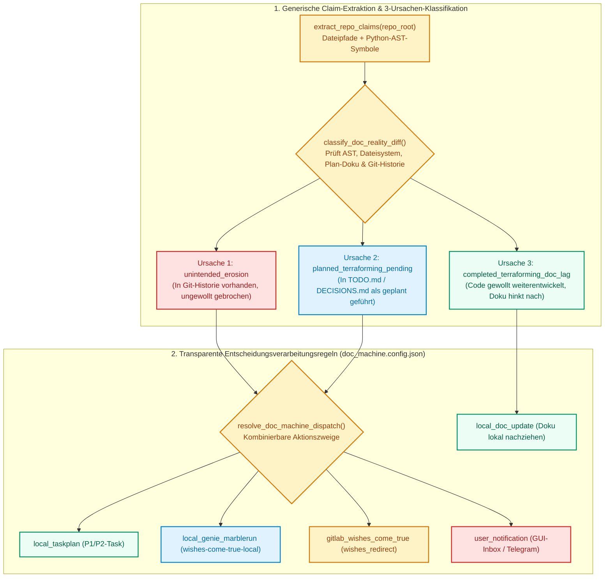

# doc-keeper — 3-Ursachen-Dokumentationsmaschine & Entscheidungs-Router (`ellmos.module.v2`)

[English](README.md) | **Deutsch**

`doc-keeper` (`ellmos-doc-keeper`) ist ein eigenständiges, wiederverwendbares Python-Modul und CLI-Werkzeug für **Open Ocean**, **BACH** und **beliebige Git-Repositories**. Es extrahiert prüfbare Dokumentations-Aussagen (Dateipfade, Python-AST-Symbole, CLI-Flags) und klassifiziert jede Abweichung zwischen Dokumentation und Code-Realität deterministisch in eine der **3 Ursachen** anhand transparenter, frei kombinierbarer **Entscheidungsverarbeitungsregeln (`config/doc_machine.config.json`)**.

---

## Architektur: Das 3-Ursachen-Dokumentationsmodell

Stellt `doc-keeper` eine Abweichung zwischen Dokumentation (`README*.md`, `SKILL.md`, `docs/**/*.md`, `system/docs/help/*.txt`) und Code-Realität fest, überschreibt er niemals blind gewollte SOLL-Architektur:

| Ursache (`classify_doc_reality_diff`) | Bedeutung | Transparente Aktionszweige (`selected_branches`) |
|---|---|---|
| **1. `unintended_erosion`** | Doku beschreibt gewolltes SOLL, Code ist ungewollt kaputtgegangen/abgedriftet (`git log -S`-Beleg). | **`["local_taskplan", "user_notification"]`** — SOLL in Doku bewahren, P1-Reparatur-Task einstellen, Nutzer informieren. |
| **2. `planned_terraforming_pending`** | Vorauseilende Doku aus `TODO.md` / `DECISIONS.md`, im Code noch nicht fertig. | **`["local_taskplan"]`** — P2-Bau-Task prüfen/anlegen und **SOLL vs. IST** kennzeichnen. |
| **3. `completed_terraforming_doc_lag`** | Vorauseilender Code, Dokumentation hinkt hinterher. | **`["local_doc_update"]`** — Dokumentation und Übersetzungen lokal nachziehen. |



---

## Schnellstart (CLI & Python-API)

```bash
pip install -e .

# Beliebiges Repository prüfen und strukturierten JSON-Bericht ausgeben
python -m doc_keeper audit /pfad/zum/repo --json

# Aktive Entscheidungsverarbeitungsregeln eines Repos anzeigen
python -m doc_keeper rules /pfad/zum/repo
```
